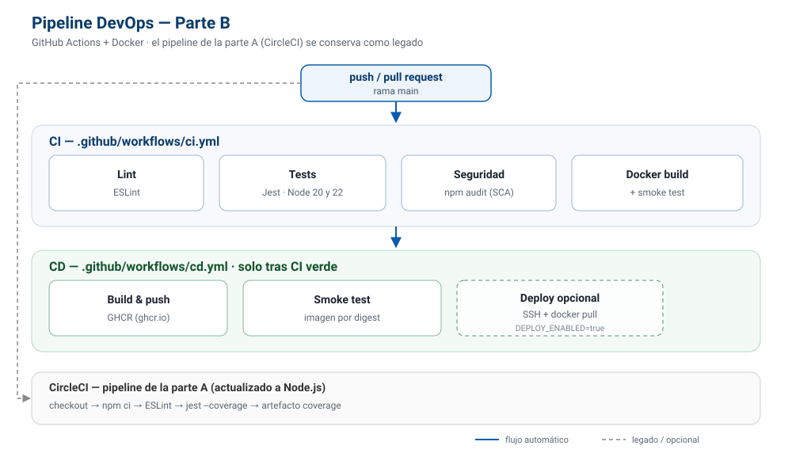

# Memoria de trabajo: implantación de un pipeline DevOps

| Campo | Valor |
| --- | --- |
| **Asignatura** | [Nombre de la asignatura] |
| **Módulo** | 2 — Integración y entrega continuas |
| **Alumno** | [Nombre y apellidos] |
| **Fecha** | 23 de noviembre de 2026 |
| **Repositorio** | `https://github.com/[usuario]/pipeline-devops` |

## Resumen ejecutivo

Esta memoria documenta la construcción de dos pipelines DevOps sobre una
misma aplicación de saludos. En la **parte A** se monta un proceso de
integración continua con **CircleCI** a partir del material entregado en el
campus: una aplicación Python, tres tests con `pytest` y un fichero de
configuración de CircleCI. En la **parte B** el proyecto evoluciona a una
aplicación **Node.js/Express**, se publica en **GitHub** y se implanta un
pipeline completo con **GitHub Actions**: integración continua con lint,
pruebas unitarias, de integración y basadas en propiedades, cobertura,
auditorías de seguridad y análisis estático; y entrega continua con
**Docker**, publicación en **GitHub Container Registry (GHCR)** y un *smoke
test* sobre la imagen publicada. El resultado pasa de 3 tests y un pipeline
solo de CI a 27 tests, ocho tipos de verificación y un CD que únicamente se
ejecuta después de que el CI haya terminado correctamente.

## 1. Introducción y objetivos

### 1.1 Contexto

La integración continua (CI) consiste en integrar los cambios en la rama
principal de forma frecuente y verificar automáticamente cada integración:
compilar, analizar el código y ejecutar los tests. La entrega continua (CD)
lleva esa base un paso más allá: si el CI es correcto, el artefacto se
publica y se despliega de forma automatizada y repetible.

El objetivo de la actividad es entender un pipeline como una cadena de
responsabilidades: **cada etapa solo debe ejecutarse si la anterior ha
pasado**, y todo el proceso debe poder reproducirse sin intervención manual.

### 1.2 Objetivos

- Implantar un primer pipeline de CI con CircleCI a partir del material del
  campus (parte A).
- Modificar el pipeline y la aplicación, cambiando de lenguaje y ampliando la
  estrategia de pruebas (parte B).
- Publicar el código en GitHub y usar GitHub Actions para CI y CD.
- Integrar Docker como mecanismo de entrega y publicar imágenes versionadas.
- Incorporar tipos de prueba adicionales: integración, propiedades,
  cobertura, análisis estático, auditoría de dependencias y *smoke test*.
- Documentar las decisiones, los problemas encontrados y las mejoras.

### 1.3 Metodología

Se trabaja con dos commits principales y dos etiquetas:

| Etiqueta | Contenido |
| --- | --- |
| `parte-a` | Aplicación Python, tests con pytest y pipeline de CircleCI |
| `parte-b` | Aplicación Node.js, pirámide de pruebas, GitHub Actions CI/CD y Docker |

El repositorio conserva la versión Python en `legacy/parte-a/` y la
configuración original del zip en `docs/reference/`, de modo que la evolución
queda trazable.



## 2. Parte A — Primer pipeline con CircleCI

### 2.1 Material de partida

El zip del campus contiene los siguientes ficheros:

| Archivo | Contenido |
| --- | --- |
| `saludar.py` | Tres funciones que devuelven saludos y un `print` aleatorio |
| `test_saludar.py` | Tres tests unitarios con `pytest` |
| `requirements.txt` | Dependencias de Python |
| `Dockerfile` | Imagen Alpine que instala Python |
| `circleci/config.yml` | Configuración del pipeline en CircleCI |

### 2.2 Análisis del código y de los tests

La aplicación tiene una parte pura y fácil de probar: `saludo1()`,
`saludo2()` y `saludo3()` devuelven cadenas constantes. Sin embargo, el
código mezcla la lógica con la ejecución: al importar el módulo se elige un
número aleatorio y se imprime un saludo. Esa mezcla tiene consecuencias:

- Los tests importan el módulo y, como efecto colateral, ejecutan el `print`.
- La selección aleatoria y la rama `else` no se prueban.
- No hay una interfaz HTTP ni un punto de entrada claro.
- No se mide la cobertura.

Los tres tests existentes son correctos y verifican el contrato de las
funciones, pero solo cubren la parte más sencilla. El Dockerfile tampoco
ejecuta la aplicación: instala Python y copia los ficheros, pero no define
`CMD`, por lo que no constituye una entrega funcional.

### 2.3 Problemas detectados en la configuración

La configuración entregada no es ejecutable hoy sin cambios. La siguiente
tabla resume los problemas y la solución aplicada:

| Problema | Consecuencia | Solución |
| --- | --- | --- |
| `version: 2` | Versión antigua de CircleCI | Migrar a `version: 2.1` |
| Imagen `circleci/python:3.7` | Imagen retirada; el job no arranca | Usar `cimg/python:3.12` |
| `pytest 6.2.2` y `flake8 3.9.0` | Versiones incompatibles con Python actual | Actualizar a `pytest 8.x` y `flake8 7.x` |
| Paso de Docker comentado | El pipeline no construye ni publica nada | Asumir que la parte A es solo CI |
| Sin caché | Cada ejecución reinstala todo | Añadir caché en la parte B |
| Sin cobertura ni artefactos | No hay evidencia medible de calidad | Añadir cobertura en la parte B |
| `source` en lugar de `.` | Menos portable entre shells | Usar `. venv/bin/activate` |

La configuración original se conserva íntegra en
`docs/reference/config-original-circleci.yml`; la versión corregida y
ejecutable está en `legacy/parte-a/circleci-config-parte-a.yml`.

### 2.4 Pipeline implementado

El pipeline de la parte A tiene un único job `build` con tres pasos:

```yaml
version: 2.1

jobs:
  build:
    docker:
      - image: cimg/python:3.12
    steps:
      - checkout
      - run:
          name: Instalar dependencias
          command: |
            python3 -m venv venv
            . venv/bin/activate
            pip install --upgrade pip
            pip install -r requirements.txt
      - run:
          name: Ejecutar flake8 y pytest
          command: |
            . venv/bin/activate
            flake8 --exclude=venv* --statistics
            pytest -v

workflows:
  ci-parte-a:
    jobs:
      - build
```

La secuencia es deliberadamente sencilla: obtener el código, preparar el
entorno y ejecutar lint y tests. El pipeline falla si `flake8` encuentra
algún aviso o si un test no pasa.

### 2.5 Puesta en marcha y evidencias

El proceso seguido fue:

1. Crear el repositorio en GitHub y subir los ficheros.
2. Entrar en CircleCI con la cuenta de GitHub.
3. Seleccionar **Set Up Project → Use existing config** para que CircleCI
   usara el `.circleci/config.yml` del repositorio.
4. Hacer un commit y observar la ejecución del workflow `ci-parte-a`.

En local, la misma secuencia produce:

- `flake8`: sin avisos.
- `pytest`: **3 tests superados**.


### 2.6 Conclusiones de la parte A

La parte A demuestra el concepto de CI con muy poca infraestructura, pero
también deja visibles sus límites: un solo job, tests escasos, sin cobertura,
sin construcción de imagen y sin entrega. Esos límites son precisamente el
punto de partida de la parte B.

<div class="page-break"></div>

## 3. Parte B — Segundo pipeline: GitHub Actions y Docker

### 3.1 Decisiones de diseño

Se reescribe la aplicación en **Node.js con Express** por tres motivos:

1. El enunciado sugiere cambiar de lenguaje y así se demuestra una migración
   real, no solo un cambio de fichero YAML.
2. Una API HTTP permite pruebas de integración reales con `supertest`, algo
   que la aplicación Python original no ofrecía.
3. Express genera una imagen Docker pequeña y un *smoke test* muy claro
   mediante el endpoint `/health`.

La lógica de negocio se separa de la infraestructura: `greetings.js` contiene
las reglas puras, `app.js` construye la aplicación Express y `server.js` es el
único punto que abre un puerto. Esta separación permite probar la app sin
levantar un servidor real.

### 3.2 Nueva aplicación

| Método | Ruta | Ejemplo | Respuesta |
| --- | --- | --- | --- |
| GET | `/` | `/` | `{"message":"Hola, mundo!"}` |
| GET | `/health` | `/health` | `{"status":"ok","uptime":1.23}` |
| GET | `/languages` | `/languages` | `{"languages":["es","en","fr"]}` |
| GET | `/greet/:name` | `/greet/Ana?lang=en` | `{"message":"Hello, Ana!"}` |

La aplicación valida el nombre (letras Unicode, espacios, apóstrofos y
guiones, hasta 50 caracteres) y el idioma (`es`, `en`, `fr`). Los errores de
validación devuelven `400` y las rutas desconocidas `404`.

Estructura del código:

```text
src/
├── app.js          # Factoría de la aplicación Express
├── greetings.js    # Lógica de negocio pura
└── server.js       # Arranque HTTP y apagado ordenado (SIGINT/SIGTERM)
```

### 3.3 Estrategia de pruebas

Se aplica una pirámide de pruebas: muchas pruebas rápidas y aisladas en la
base, menos pruebas de integración y un *smoke test* sobre el contenedor en la
cima.

| Tipo | Herramienta | Qué comprueba | Nº |
| --- | --- | --- | --- |
| Unitarias | Jest | Saludos, validación de nombres e idiomas | 17 |
| Integración | Jest + Supertest | Rutas HTTP, códigos 200/400/404 y cuerpo de las respuestas | 8 |
| Basadas en propiedades | fast-check | Invariantes sobre cientos de nombres e idiomas generados | 2 |
| Cobertura | Jest | Umbral mínimo de 80 % en ramas y 85 % en líneas/funciones | — |
| Estática | ESLint | Errores, variables sin usar y malas prácticas | — |
| Dependencias (SCA) | `npm audit` | Vulnerabilidades conocidas en dependencias de producción | — |
| Seguridad estática (SAST) | CodeQL | Patrones inseguros en el código | — |
| Contenedor | Docker + `curl` | La imagen arranca y `/health` responde | — |

**Total: 27 tests.** La cobertura obtenida es del **97,05 %** en sentencias y
líneas, **92,3 %** en ramas y **100 %** en funciones. La única rama sin cubrir
es la respuesta `500`, que requiere un error inesperado no reproducible con
la lógica actual; se mantiene como red de seguridad.

Las pruebas basadas en propiedades merecen una explicación: en lugar de
escribir ejemplos concretos, se declara una propiedad que debe cumplirse
siempre y `fast-check` genera entradas aleatorias para intentar falsearla.
Por ejemplo:

- Para cualquier nombre válido, `greet(name)` debe empezar por `"Hola, "`,
  terminar en `"!"` e incluir el nombre.
- Para cualquier idioma fuera del catálogo, `greet` debe lanzar
  `RangeError`.

Esto complementa a los tests de ejemplo: encuentra casos límite que no se
habrían escrito a mano.

Ejemplo de prueba de integración:

```js
test('GET /greet/Ana?lang=en saluda en inglés', async () => {
  const res = await request(app).get('/greet/Ana?lang=en').expect(200);
  expect(res.body.message).toBe('Hello, Ana!');
});
```

### 3.4 Repositorio en GitHub

El repositorio se organiza con `main` como rama protegida, dos etiquetas
(`parte-a` y `parte-b`) y workflows separados por responsabilidad. La
protección de `main` exige que los checks del CI estén en verde antes de
fusionar un pull request. Las capturas B1 y B7 documentan la estructura y la
configuración de la rama.


### 3.5 Integración continua con GitHub Actions

`.github/workflows/ci.yml` se ejecuta en cada `push` a `main` y en cada pull
request. Incluye cuatro jobs:

| Job | Qué hace | Detalle |
| --- | --- | --- |
| `lint` | ESLint sobre todo el proyecto | Falla ante cualquier error |
| `test` | Jest con cobertura | Matriz Node 20 y 22; umbral de cobertura |
| `security` | `npm audit --omit=dev` | Falla con vulnerabilidades altas o críticas |
| `docker-build` | Construcción de la imagen y *smoke test* | Depende de lint, test y security |

Decisiones técnicas relevantes:

- **Matriz de versiones**: el mismo código se prueba en Node 20 (LTS) y Node
  22, lo que detecta incompatibilidades entre versiones.
- **Caché de npm**: `actions/setup-node` con `cache: npm` evita descargar
  dependencias en cada ejecución.
- **Caché de Docker**: `cache-from/cache-to: type=gha` reutiliza capas entre
  ejecuciones y acelera la construcción.
- **Concurrencia**: si se empujan varios commits seguidos al mismo ref, la
  ejecución anterior se cancela (`cancel-in-progress: true`).
- **Permisos mínimos**: el workflow solo necesita `contents: read`.
- **Artefacto de cobertura**: el informe `coverage/` se publica como
  artefacto descargable durante 7 días.

El job `docker-build` construye la imagen **antes** de que el CD publique
nada. Así se detecta un Dockerfile roto en el CI y no en el momento del
despliegue.


### 3.6 Entrega continua con Docker

`.github/workflows/cd.yml` no se dispara con cada `push`: usa el evento
`workflow_run` para ejecutarse **solo cuando el workflow CI ha terminado con
éxito sobre `main`**. También admite tags `v*` y ejecución manual.

El job `publish`:

1. Hace checkout del **commit exacto** que validó el CI
   (`github.event.workflow_run.head_sha`).
2. Construye la imagen de producción.
3. Se autentica en GHCR con el `GITHUB_TOKEN` efímero del workflow.
4. Publica la imagen con tags de rama, tag, SHA y `latest`.
5. Exporta el **digest inmutable** (`sha256:...`).

El job `smoke-test` descarga la imagen publicada **por digest**, la arranca y
comprueba que `/health` responde. Se prueba exactamente el artefacto que se
ha publicado, no una reconstrucción local. El job `deploy` es opcional y solo
se activa con la variable `DEPLOY_ENABLED=true`; despliega por SSH en un
servidor con Docker y la misma imagen por digest.

El Dockerfile es multi-stage:

```dockerfile
FROM node:20-alpine AS deps
WORKDIR /app
COPY package.json package-lock.json ./
RUN npm ci --omit=dev

FROM node:20-alpine
ENV NODE_ENV=production
WORKDIR /app
COPY --from=deps /app/node_modules ./node_modules
COPY package.json ./
COPY src ./src
USER node
EXPOSE 3000
HEALTHCHECK CMD wget -qO- http://127.0.0.1:3000/health || exit 1
CMD ["node", "src/server.js"]
```

Ventajas: la imagen final no contiene `devDependencies`, tests ni documentación;
se ejecuta como usuario sin privilegios; incluye un `HEALTHCHECK` que Docker
y el orquestador pueden usar; y el `package-lock.json` garantiza instalaciones
reproducibles con `npm ci`.


### 3.7 Seguridad del pipeline

| Medida | Para qué |
| --- | --- |
| `permissions` mínimos por workflow y job | Limitar el alcance del `GITHUB_TOKEN` |
| `GITHUB_TOKEN` en lugar de credenciales fijas | Token efímero y rotado por GitHub |
| Sin secretos en el repositorio | Evitar filtraciones; `.gitignore` y `.dockerignore` |
| `npm audit --omit=dev` | Detectar vulnerabilidades en dependencias de producción |
| CodeQL | Análisis estático de patrones inseguros |
| Contenedor non-root | Reducir el impacto de una vulnerabilidad en la app |
| Imagen Alpine mínima | Menos superficie de ataque |
| Protección de `main` | Evitar fusiones sin CI en verde |
| Entorno `production` en el deploy | Permite exigir revisión manual antes de desplegar |

Como mejora futura, en un entorno real conviene fijar las *actions* por SHA
en lugar de por etiqueta, y usar *pull requests* de Dependabot para mantener
las dependencias actualizadas.

### 3.8 Comparativa CircleCI y GitHub Actions

| Criterio | CircleCI | GitHub Actions |
| --- | --- | --- |
| Integración con GitHub | Servicio externo con OAuth | Nativa |
| Configuración | `.circleci/config.yml` | `.github/workflows/*.yml` |
| Ejecutores | Docker, máquina y macOS | Ubuntu, Windows, macOS y contenedores |
| Reutilización | Orbs | Actions del Marketplace |
| Matriz de versiones | `matrix` en la configuración | `strategy.matrix` |
| Secretos | Variables y contextos | Secrets y environments |
| Registro de imágenes | Credenciales de registro externo | GHCR con `GITHUB_TOKEN` |
| Coste | Plan gratuito con límites | Minutos gratuitos según plan; GHCR incluido |
| Curva de aprendizaje | Media | Baja si el código ya está en GitHub |

GitHub Actions simplifica el proyecto porque el código, los *issues*, los
pull requests, los checks y el registro de imágenes viven en el mismo sitio.
CircleCI sigue siendo una opción sólida y su configuración es algo más
explícita, pero obliga a gestionar una integración adicional y credenciales
de registro por separado.

### 3.9 Mejoras respecto a la parte A

1. **Cambio de lenguaje y de arquitectura**: de un script Python con `print`
   a una API Express con separación entre lógica, aplicación y servidor.
2. **De 3 a 27 tests**, con pruebas unitarias, de integración y basadas en
   propiedades.
3. **Cobertura medida y exigida**: umbral que rompe el pipeline si baja.
4. **Lint moderno y reproducible** con ESLint y configuración versionada.
5. **Auditoría de dependencias (SCA)** integrada en el CI.
6. **Análisis estático de seguridad (SAST)** con CodeQL.
7. **Matriz de Node 20 y 22** para detectar incompatibilidades.
8. **Caché de npm y de Docker** para reducir tiempos.
9. **Cancelación de ejecuciones obsoletas** y permisos mínimos.
10. **Dockerfile multi-stage, non-root y con healthcheck**, inexistente en la
    parte A.
11. **CD real**: publicación en GHCR, referencia por digest y *smoke test* de
    la imagen publicada.
12. **CD condicionado al CI**: no se publica nada si el CI no está en verde
    sobre `main`.
13. **Despliegue opcional por SSH** con la misma imagen inmutable.
14. **Trazabilidad**: etiquetas `parte-a`/`parte-b`, configuración original
    conservada y memoria versionada junto al código.

### 3.10 Evidencias adicionales


## 4. Conclusiones

La actividad muestra que un pipeline no es solo un fichero YAML: es una
cadena de garantías. La parte A permitió comprobar lo sencillo que resulta
ejecutar tests en la nube con CircleCI, pero también que un pipeline sin
cobertura, sin imagen y sin entrega se queda a medio camino. La parte B
convierte ese esqueleto en un proceso completo:

- **Calidad medible**: 27 tests, cobertura con umbral y análisis estático.
- **Seguridad integrada**: auditoría de dependencias, CodeQL, permisos
  mínimos y contenedor sin privilegios.
- **Entrega reproducible**: imagen inmutable publicada en GHCR y probada
  antes de cualquier despliegue.
- **Automatización condicionada**: el CD solo avanza si el CI ha pasado.

El aprendizaje principal es que la automatización debe ser **fallar pronto y
fallar claro**: es mejor detectar un Dockerfile roto en el CI que en el
servidor de producción, y es mejor que un umbral de cobertura rompa el
pipeline a que la calidad se degrade en silencio.

Como líneas de trabajo futuras: separar entornos de *staging* y producción,
usar *Infrastructure as Code* (Terraform), añadir Dependabot, firmar imágenes
con `cosign`, desplegar en Kubernetes y añadir observabilidad (métricas y
logs centralizados).

## 5. Referencias

- CircleCI. *Configuration reference*.
  <https://circleci.com/docs/configuration-reference/>
- CircleCI. *Convenience images*.
  <https://circleci.com/developer/images>
- GitHub. *GitHub Actions documentation*.
  <https://docs.github.com/en/actions>
- GitHub. *Events that trigger workflows: workflow_run*.
  <https://docs.github.com/en/actions/using-workflows/events-that-trigger-workflows#workflow_run>
- GitHub. *Working with the Container registry*.
  <https://docs.github.com/en/packages/working-with-a-github-packages-registry/working-with-the-container-registry>
- Docker. *Multi-stage builds*.
  <https://docs.docker.com/build/building/multi-stage/>
- Docker. *build-push-action*.
  <https://github.com/docker/build-push-action>
- Docker. *metadata-action*.
  <https://github.com/docker/metadata-action>
- GitHub. *CodeQL*.
  <https://codeql.github.com/>
- Jest. *Documentation*.
  <https://jestjs.io/docs/getting-started>
- Supertest. *Documentation*.
  <https://github.com/ladjs/supertest>
- fast-check. *Documentation*.
  <https://fast-check.dev/>
- ESLint. *Documentation*.
  <https://eslint.org/docs/latest/>

<div class="page-break"></div>

## Anexo A — Comandos utilizados

### Comprobaciones locales

```bash
npm ci
npm run lint
npm run test:coverage
npm run security
npm run verify
npm start
```

### Git y GitHub

```bash
git init -b main
git add -A
git commit -m "Parte A: pipeline de CI con CircleCI"
git tag -a parte-a -m "Parte A: CircleCI"
git commit -m "Parte B: Node.js, GitHub Actions y Docker"
git tag -a parte-b -m "Parte B: CI/CD completo"

git remote add origin https://github.com/[usuario]/pipeline-devops.git
git push -u origin main --tags
```

### Reproducir la parte A en CircleCI

```bash
git branch parte-a-demo parte-a
git push origin parte-a-demo
# Conectar el proyecto en CircleCI y capturar la ejecución
git push origin --delete parte-a-demo
git branch -d parte-a-demo
```

### Publicar una release

```bash
git tag -a v2.0.0 -m "Parte B: CI/CD con GitHub Actions"
git push origin v2.0.0
```

### Docker

```bash
docker build -t pipeline-devops .
docker run --rm -p 3000:3000 pipeline-devops
docker compose up --build
```

### Generar la memoria imprimible

```bash
npm run docs:build
open docs/memoria.html   # Imprimir → Guardar como PDF
```

## Anexo B — Checklist de capturas

| Figura | Archivo | Estado |
| --- | --- | --- |
| A1 | `capturas/a1-repo-github.png` | Pendiente |
| A2 | `capturas/a2-circleci-setup.png` | Pendiente |
| A3 | `capturas/a3-pipeline-verde.png` | Pendiente |
| A4 | `capturas/a4-detalle-tests.png` | Pendiente |
| A5 | `capturas/a5-log-pytest.png` | Pendiente |
| B1 | `capturas/b1-estructura-repo.png` | Pendiente |
| B2 | `capturas/b2-actions-ci.png` | Pendiente |
| B3 | `capturas/b3-cobertura.png` | Pendiente |
| B4 | `capturas/b4-codeql.png` | Pendiente |
| B5 | `capturas/b5-cd-smoke.png` | Pendiente |
| B6 | `capturas/b6-ghcr-package.png` | Pendiente |
| B7 | `capturas/b7-branch-protection.png` | Opcional |
| B8 | `capturas/b8-pr-checks.png` | Opcional |

## Anexo C — Guion de defensa

**1. ¿Qué es CI y qué es CD?**
CI es integrar cambios con frecuencia y verificar cada integración de forma
automática (lint, tests, build). CD automatiza la publicación y el despliegue
del artefacto validado. En el proyecto, `ci.yml` es CI y `cd.yml` es CD.

**2. ¿Por qué dos pipelines?**
La parte A exigía CircleCI con el material del campus. La parte B pedía
cambiar la aplicación, usar GitHub y GitHub Actions. Conservar ambos permite
comparar herramientas y demostrar la migración sin perder trazabilidad.

**3. ¿Qué tipos de prueba has integrado?**
Unitarias, de integración, basadas en propiedades, cobertura, lint, auditoría
de dependencias, análisis estático de seguridad y *smoke test* del contenedor.

**4. ¿Qué aporta el testing basado en propiedades?**
Genera entradas automáticamente y comprueba invariantes. Complementa los
ejemplos escritos a mano y explora casos límite que no se habrían previsto.

**5. ¿Cómo evitas desplegar código roto?**
El CD usa `workflow_run`: solo se ejecuta si el workflow CI terminó con éxito
sobre `main`. Además, el *smoke test* se ejecuta sobre la imagen publicada por
digest antes del despliegue opcional.

**6. ¿Por qué publicar por digest y no solo por tag?**
Un tag puede moverse; un digest `sha256:...` identifica de forma inmutable el
contenido exacto de la imagen. El *smoke test* y el despliegue usan el mismo
digest.

**7. ¿Cómo proteges los secretos?**
No hay secretos en el código. El CD usa el `GITHUB_TOKEN` efímero para GHCR y,
si se activa el despliegue, secretos del repositorio y un entorno
`production` que puede exigir aprobación.

**8. ¿Qué ventaja tiene la matriz de Node 20 y 22?**
Prueba el mismo código en dos versiones del runtime y detecta APIs o
comportamientos incompatibles antes de que lleguen a producción.

**9. ¿Qué harías para mejorar el pipeline?**
Añadir *staging*, Dependabot, firma de imágenes con `cosign`, análisis de
secretos, despliegue en Kubernetes y observabilidad.

**10. ¿Qué has aprendido de la parte A a la parte B?**
Que la CI sin entrega se queda corta y que la calidad debe medirse. Pasar de
3 tests a 27 y de un pipeline solo de CI a un CI/CD condicionado cambia por
completo la confianza en cada cambio.
